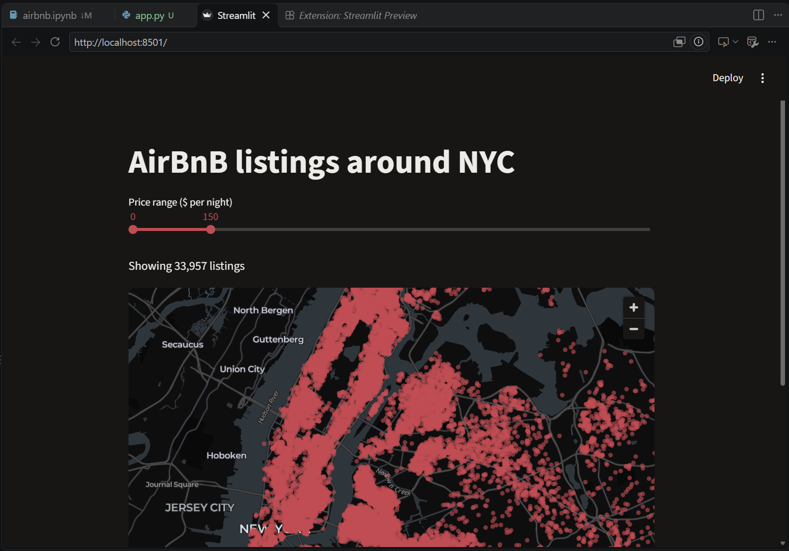

# Team Members
```text
Daveyon Brown
Jordan Hall
Dhrubo Mondal
Barrett Tucker
```

# Brief description of the problem and dataset
```text
For this lab we used the airbnb data from Kaggle given to us in the Week 7 activity 'Can we trust the airbnb data' where we inspected the data, identified problems, determined how each problem should be handled, and justified our decisions
```

# Voila


# Binder
https://mybinder.org/v2/gh/Barrettttttt/CAP5771-Lab3/main?urlpath=voila%2Frender%2Fairbnb.ipynb

# Streamlit



# Docker Hub
https://hub.docker.com/r/jhall3063/lab-3

# Docker Demonstration
Run
```bash
docker pull jhall3063/lab-3:latest
docker run -d jhall3063/lab-3:latest 
```